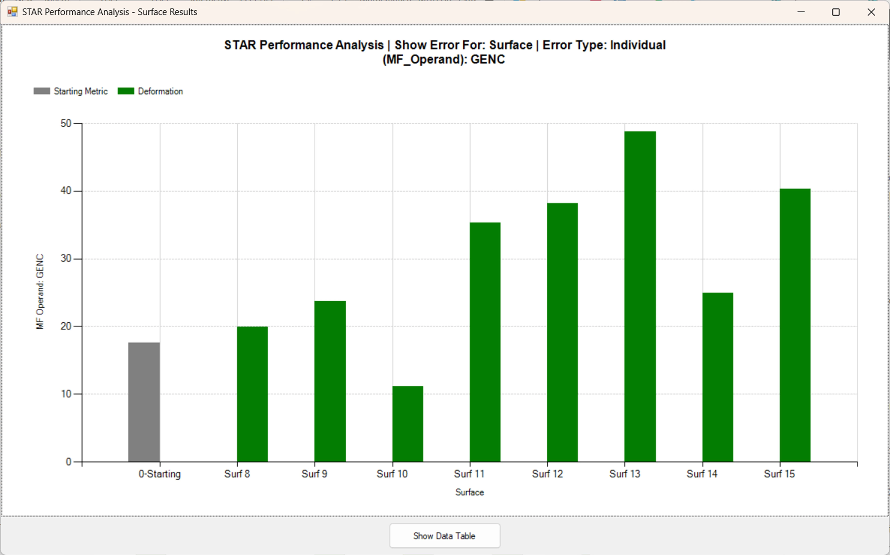
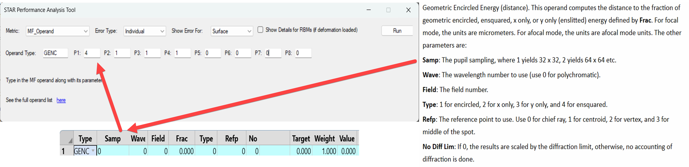

# STAR Performance Analysis Add-on - Python API & User Extension

## Overview
This is the User Extension and the Python API Standalone script for the STAR Performance Analysis Add-on. Allowing the user to extend the capabilities of the native Performance Analysis to any Merit Function operand and the Merit Function value itself.

Short description – The script launches an interface in which the user can choose some pre-defined metric or define their own metric. All metrics are based on a given Merit Function Operand and all parameters which do apply to the chosen operand type must be set accordingly to get a valuable result:

**Disclaimer**: There only has been limited testing on both script and extension. Please do check the results thoroughly. For the API script, Python 3.12 and 3.13 have been tested. See here the Help File page of the native [Performance Analysis](https://ansyshelp.ansys.com/account/secured?returnURL=%2FViews%2FSecured%2FZemax%2Fv25202%2Fen%2FOpticStudio_User_Guide%2FOpticStudio_Help%2Ftopics%2FPerformance_Analysis.html). 

## Authors
**Tony Chatzikostas**,
**Flurin Herren**

## Installation / How to use

Below are steps to run it as either a User Extension (#1) or a Python API Standalone script (#2):

1. Place User Extension executable in Zemax Working Folder. Default Installation: “….\Documents\Zemax\ZOS-API\Extensions” to run the extension. The FEA Datasets need to be loaded into the system before running the extension.

2. Add the path of the file to load on line 1402. The custom directory version is set to False, meaning the script will use the default version of Zemax, if desired otherwise set USE_CUSTOM_VERSIO to True and define the version on line 1399 with the CUSTOM_DIRECOTRY. The FEA Datasets need to be loaded into the system before running the script.