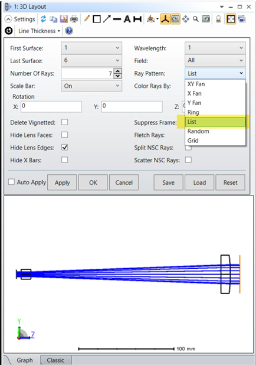

# ZPL Macro: ZPL Macro: RayList Gaussian Beam Visualizer

## Overview

This ZPL macro generates a file under "\Zemax\Miscellaneous\RAYLIST.TXT" to represent the envelope of a Gaussian beam. There are 3 user inputs: the Waist Size w0, Surf 1 to Waist and the M2 Factor. The macro generates a list of 16 rays based on Paul Colbourne's skew rays: Using skew rays to model Gaussian beams. These rays can be displayed in the 3D layout or Shaded Model by selecting under the settings Pattern...List. 

## Author

Michae Humphreys

## Language
ZPL

## Instructions

## 1.	Installation

Place the macro in the {Zemax}\Macros folder

## 2.	How to use

In OpticStudio, navigate to Programming…Edit/Run and run the macro.
Enter the desired waist, surface 1 to waist offset and M2 (these have the same units and sign convention as the Paraxial Gaussian Beam analysis). 

If you edit the macro, you can also change the field and wavenumber variables

Under the 3D layout or Shaded Model settings, select Ray Pattern…List. Note that your old RAYLIST.txt will be overwritten so if this is needed for your analysis, please save a copy.

 
## A bit of context:

OpticStudio has several specific analysis features to model different aspects of a sequential optical design, such as 3rd Order Wavefront aberrations (Seidel), single-step diffraction (FFT or Huygens) or extended scene analyses. All these analyses fundamentally rely upon geometric ray tracing and pure geometric ray tracing does not adequately describe a Gaussian beam. If you take a simple free space propagation, rays will either travel in a straight line (infinite conjugate) or linearly diverge (finite conjugate):

 
To model Gaussian (and other more complex beams), OpticStudio has a Laser and Fibers analysis section which includes:
1.	Physical Optics Propagation
2.	Paraxial Gaussian Beam
3.	Skew Gaussian Beam
4.	Single/Multi-Mode Coupling

The first 3 analyses behave uniquely in the sense that the beam size is determined within the analysis settings directly and the values entered in the System Explorer are ignored. This is because Gaussian (and more complex) beams are more accurately modeled using unique beam characteristics such as waist, divergence, and wavelength.

The 3D Layout plot however traces rays based on the values entered in the System Explorer. Therefore, it is often difficult to ensure the settings for Physical Optics Propagation, Paraxial Gaussian Beam, and Skew Gaussian Beam are setup correctly. The one exception to the 3D Layout using the System Explorer settings is when you use the RAYLIST.txt file to define the rays you want to show.

By default, this is just a 2-column list which has the Px/Py normalized pupil coordinates. However, if you begin the RAYLIST.txt file with the keyword EXPLICIT then you can directly display rays based on the XYZ starting position and LMN direction cosines.

You can easily view the Gaussian (TEM00) envelop of any system by using Paul Colbourne's (Senior Optical Design at Lumentum) Skew Rays Method (as described in SPIE 9293, Generally Astigmatic Gaussian Beam Representation and Optimization Using Skew Rays, December 2014). Paul also has an amazing presentation, User Defined Surface and example files on MyZemax for OpticStudio customers with access to website. Paul's method of representing the Gaussian envelop using geometric rays is extremely simple; namely, by offsetting the x0 and y0 components of the initial beam as a function of waist and divergence angle and m0 and l0 respectively (that is, the x component is modified by the y-direction cosine and the y component is modified by the x-direction cosine), the geometric rays then have a rotation or twist in them as they propagate.

$$ \begin{aligned} x &= x + \frac{m\omega_0}{|\theta_0|} \\ y &= y - \frac{l\omega_0}{|\theta_0|} \end{aligned} $$

If enough rays are traced, this twist will outline the Gaussian envelope when viewed in the 3D Layout.

 
With a simple ZPL macro, you can easily generate a RAYLIST.txt file as a function of waist, Surface 1 to Waist offset and M2 value. If you look at the Paraxial Gaussian Beam settings, you can see that these are the same 3 settings for this analysis; Physical Optics Propagation also allows you to define a Surface to Beam offset and WaistX\WaistY value. In a free-space propagation system, using the actual ray trace data from the RAYLIST, you can compare the results of the Skew Rays method, the Paraxial Gaussian Beam and POP analyses:

$$ \begin{array}{|c|c|} \hline \text{Parameter} & \text{Value} \\ \hline w_0 & 0.005 \\ \text{S1 to Waist} & 0.5 \\ M^2 & 1 \\ \hline \end{array} $$ $$ \begin{array}{|c|c|c|c|} \hline \text{Surface} & \text{Skew Rays} & \text{PGB} & \text{POP} \\ \hline S1 & 1.82002\times10^{-2} & 1.82070\times10^{-2} & 1.82070\times10^{-2} \\ S2 & 5.00000\times10^{-3} & 5.00000\times10^{-3} & 5.00000\times10^{-3} \\ S3 & 5.27372\times10^{-2} & 5.27586\times10^{-2} & 5.27586\times10^{-2} \\ \hline \end{array} $$
 
This visualization method is primarily designed to ensure the setup of these Laser and Fibers analysis are correct since the 3D Layout is decoupled from the System Explorer, that is verifying that the waist, divergence, and beam footprint on the first surface is expected. With highly aberrated systems, the true Gaussian envelope will most likely start to diverge from the skewed rays, but for "well corrected" systems this envelop should be correct.

https://www.linkedin.com/pulse/visualize-gaussian-beam-envelope-sequential-mode-michael-humphreys 

## Download
<table>

<tr>

<th>Date</th>

<th>Version</th>

<th>OpticStudio Version</th>

<th>Comment</th>

<tr>

<tr>
<td>2021/07/23</td>

<td>2.0</td>

<td> - </td>

<td>Added the definable variables as input<td>
<tr>
<td>2021/04/01</td>

<td>1.0</td>

<td> - </td>

<td>Creation<td>
<tr>
