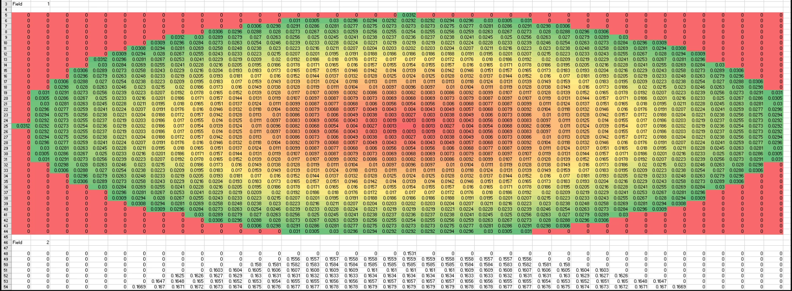

# ZPL Macro: Read optimization operand across pupil

## Overview

Output of the macro with some additional post-processing in Excel

This macro may be used as a basis for gathering field-by-field ray data in equal steps across the pupil. In this macro, the angle of incidence on a surface is reported but the operand may be changed to any that uses normalized ray coordinates. 

## Author

Alexandra Culler

## Language
ZPL

## Instructions

1. Installation 
Copy the macro to the {Zemax}\Macros folder on your machine.  

2. How to use 
In OpticStudio, navigate to Programming…Edit/Run and open the macro for editing. Modify lines 6, 7, 
and 8. These correspond respectively to the number of steps across the pupil, the surface of interest, and the wavelength of interest. 

On line 56 we define which optimization operand we will use for this analysis. Be default, we are using RAID. If the operand is updated, you must make sure line 60 is still valid. Line 60 represents the operand inputs. For the RAID operand, we input the following:

Once the values of the macro are confirmed, save it and run. The output will be a field-by-field analysis of the optimization operand at different pupil locations on a given surface. The text can be directly output to an external file, or copied from the Text Viewer into a post-processing program. 

## Download
<table>

<tr>

<th>Date</th>

<th>Version</th>

<th>OpticStudio Version</th>

<th>Comment</th>

<tr>

<tr>
<td>2019/12/10</td>

<td>1.0</td>

<td>19.8</td>

<td>Creation<td>
<tr>
<td>2020/09/20</td>

<td>1.1</td>

<td>20.2</td>

<td>Updates for OpticsTalk+Envision 
Cleaning up the output. Additionally, a reformatted version has been made available which splits the calculation into child/parents macros.
<tr>

