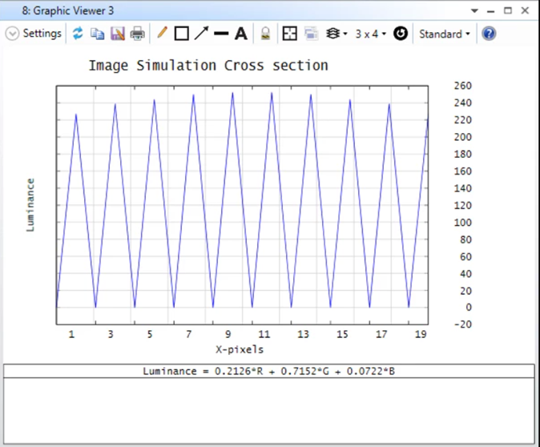

# ZPL Macro: Sequential - Image Simulation Cross Section

## Overview

This macro reads the text output of the image simulation.  The text output contains the RGB values of the image for each pixel. It then creates a cross section of the image simulation in X or Y for a defined X or Y pixel.

In the Image Simulation window, click on Save first before running it

## Author

Sandrine Auriol

## Language
ZPL

## Created Date

2021 -12 -09

## Instructions 
1. Installation 
To run the macro, copy the .zpl file under {Zemax}\Macros. 
The macro can then be run from: 

2. How to use 
The macro will run the image simulation and reads the RGB values.  

It will then display a cross section: 4 plots are displayed. 

    1. One for the G values 
    2. One for the B values 
    3. One for the luminance values calculated from the RGB values. 

The Luminance formula used here is: 
Luminance = 0.2126 * R + 0.7152 * G + 0.0722 * B 
It comes from the following sources:  

    1. https://en.wikipedia.org/wiki/Luma_(video) 
    2. https://stackoverflow.com/questions/596216/formula-to-determine-perceived-brightness-of-rgb-color 
    3. https://www.itu.int/rec/R-REC-BT.709